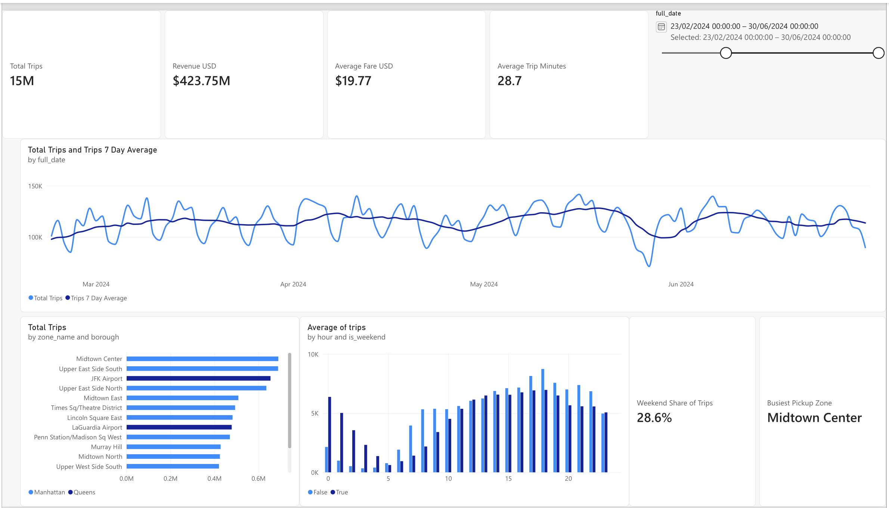
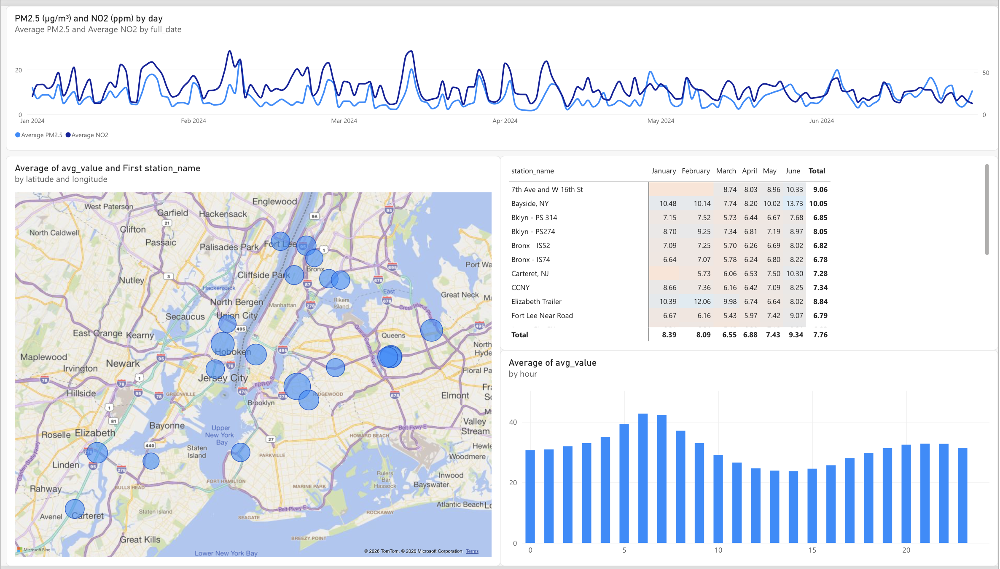
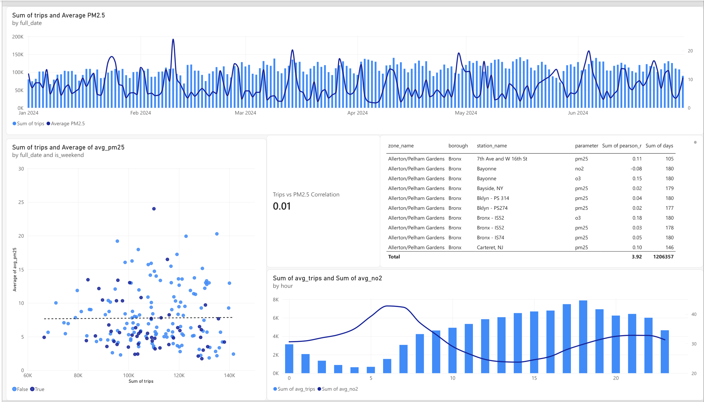
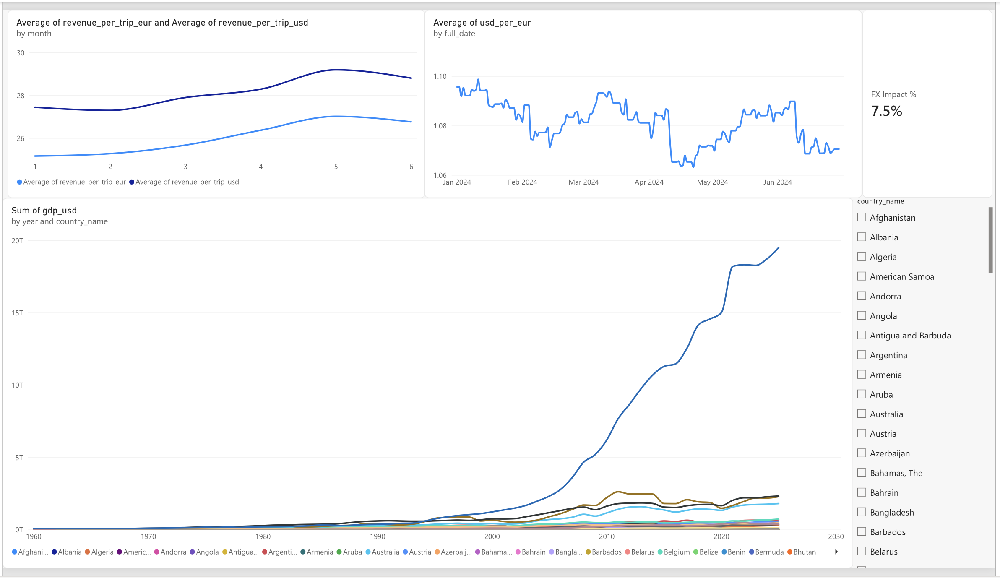
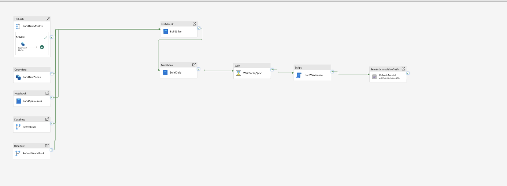

# urban-analytics-fabric

Course project on Microsoft Fabric: NYC taxi trips, air quality (OpenAQ), GDP (World Bank) and USD/EUR rates (ECB) in one lakehouse and warehouse, with a Power BI report. Weather (Open-Meteo) was added as an extra source.

Medallion architecture: bronze (raw) → silver (cleaned, PySpark) → gold (star schema) → Fabric Warehouse → Power BI.

## Repository

```
urban_analytics/     PySpark code for silver and gold, API clients
tests/               pytest on local Spark with synthetic data
fabric/
  notebooks/         notebooks that call the package
  dataflows/         Dataflow Gen2 queries (ECB, World Bank)
  pipelines/         daily_refresh pipeline
  warehouse/         star schema, load procedures, report views
  powerbi/           DAX measures
docs/                data dictionary, lineage, governance, screenshots
```

## Sources

| Source | Ingestion | Bronze |
|---|---|---|
| NYC TLC yellow taxi (Parquet) + zone lookup (CSV) | pipeline, Copy activity | `lh_bronze/Files/taxi/...` |
| ECB USD/EUR | Dataflow Gen2 | `ecb_fx_usd_eur` |
| World Bank GDP | Dataflow Gen2 | `worldbank_gdp` |
| OpenAQ v3 (PM2.5, NO2, O3) | notebook `00_land_api_sources` | `openaq_hourly` |
| Open-Meteo | notebook `00_land_api_sources` | `openmeteo_daily` |

OpenAQ is loaded from a notebook instead of a Dataflow because it needs paging per sensor, a rate limit of 60 requests per minute with retry on HTTP 429, and an API key passed as a secure parameter.

## Report

| Mobility | Air quality |
|---|---|
|  |  |
| **Mobility vs air quality** | **Economy** |
|  |  |

Results for January–June 2024:

- 20 M trips, 564 M USD revenue, 19.46 USD average fare, 28.4 min average trip. Busiest pickups: Midtown, Upper East Side, JFK and LaGuardia.
- NO2 peaks at 6–7 am with the morning rush and is lowest in the early afternoon.
- Daily trips vs city PM2.5: Pearson r = 0.03, so taxi volume does not explain PM2.5.
- Revenue per trip is 7.5 % lower in EUR than in USD.

## Pipeline



Taxi copy, API notebook and both Dataflows run in parallel → `02_build_silver` → `03_build_gold` → wait for the SQL endpoint sync → `EXEC dbo.LoadGold; EXEC dbo.LoadReportTables;` → semantic model refresh. Scheduled daily.

## Problems found on real data

- **Time zone.** OpenAQ hours are UTC, taxi hours are New York time. The first chart showed the NO2 peak at 10–11; after conversion to local time it is at 6–7.
- **Units.** NO2 and O3 come in ppm, PM2.5 in µg/m³. Silver converts everything to µg/m³.
- **World Bank aggregates.** The API mixes countries with groups like "World" or "Euro area". They go to the rejected table.
- **Warehouse.** `TRUNCATE` is not allowed on tables with foreign keys, so the load uses `DELETE`. Direct Lake cannot use views, so report views are saved as `Rpt*` tables.
- **SQL endpoint delay.** The lakehouse SQL endpoint sees new Delta versions with a delay, so the pipeline waits before loading the warehouse.

## Running locally

```bash
pip install -e ".[dev]"
pytest
```

## Deploying to Fabric

1. Workspace with `lh_bronze`, `lh_silver`, `lh_gold` (no schemas) and `wh_analytics`.
2. `pip wheel . --no-deps -w dist`, upload the wheel to an Environment and attach it to the notebooks.
3. Import `fabric/notebooks`, create the two Dataflows from `fabric/dataflows/*/query.pq` (Blank query, destination `lh_bronze`).
4. Run `fabric/warehouse/01`–`04` in `wh_analytics`.
5. Build `daily_refresh` as in `fabric/pipelines/daily_refresh.json` and schedule it.
6. Semantic model on `wh_analytics` (Direct Lake), measures from `fabric/powerbi/measures.dax`.

## Documentation

- [Data dictionary](docs/data_dictionary.md)
- [Lineage](docs/lineage.md)
- [Governance](docs/governance.md)
