# Lineage

Orange is bronze, grey is silver, teal is gold, dashed are the warehouse views.

## Source to bronze

| Source | Landed by | Bronze |
|---|---|---|
| NYC TLC yellow taxi, monthly Parquet | pipeline, ForEach + Copy over HTTP | `Files/taxi/yellow/yellow_tripdata_YYYY-MM.parquet` |
| NYC TLC zone lookup | pipeline, Copy over HTTP | `Files/taxi/zones/taxi_zone_lookup.csv` |
| OpenAQ v3, hourly PM2.5, NO2, O3 within 25 km of NYC | notebook `00_land_api_sources` | table `openaq_hourly` |
| Open-Meteo daily archive | notebook `00_land_api_sources` | table `openmeteo_daily` |
| ECB USD/EUR reference rate | Dataflow Gen2 | table `ecb_fx_usd_eur` |
| World Bank GDP, current USD | Dataflow Gen2 | table `worldbank_gdp` |

## Bronze to silver

Every silver table has a `<table>_rejected` twin with a `reject_reason`, so bronze rows = accepted + rejected + exact duplicates.

## Silver to gold

| Gold table | Built from |
|---|---|
| dim_date | the processing window |
| dim_zone | taxi_zones |
| dim_station | air_quality_hourly, latest name per station |
| dim_fx | fx_rates_daily on the calendar, gaps filled forward |
| dim_gdp | gdp_annual |
| fact_taxi_daily | taxi_trips by day and pickup zone, EUR via dim_fx |
| fact_taxi_hourly | taxi_trips by day and hour |
| fact_air_quality_daily | air_quality_hourly by day, station and parameter |
| fact_air_quality_hourly | air_quality_hourly by day, hour and parameter |
| fact_urban_daily | one row per day: city taxi totals, pollution means, weather, FX |
| fact_zone_station_correlation | Pearson r between zone trips and station readings per day |

## Gold to report

`dbo.LoadGold` copies gold into `wh_analytics`. The views in `03_analytical_views.sql` answer the brief's questions and `dbo.LoadReportTables` materialises them as `Rpt*` tables, because Direct Lake cannot read views.

| Question | Table |
|---|---|
| Trips vs PM2.5 and NO2 | `FactUrbanDaily` |
| Strongest zones and hours | `RptZoneStationLinks`, `RptDemandByHour` |
| Revenue per trip USD vs EUR | `RptRevenuePerTrip` |
| Growth over years vs environment | `RptYearlyGrowth` |

Fabric also shows item-level lineage in the workspace lineage view.
